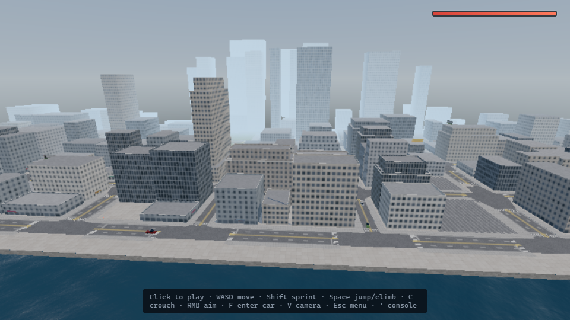
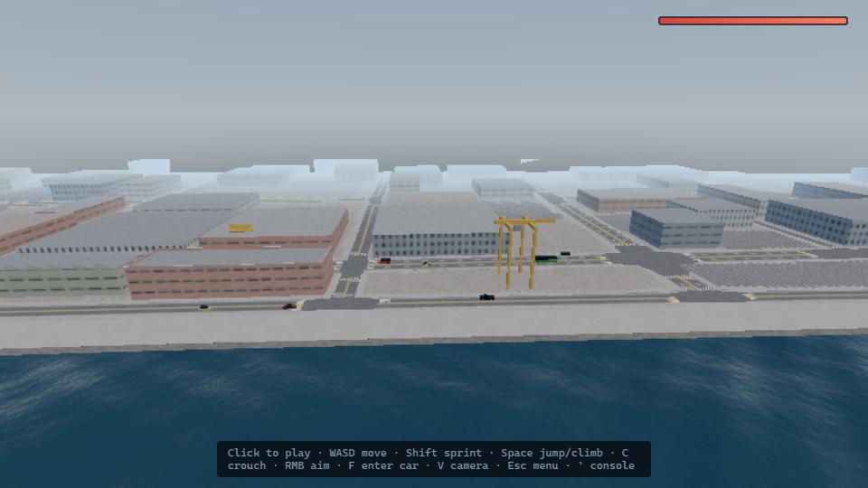
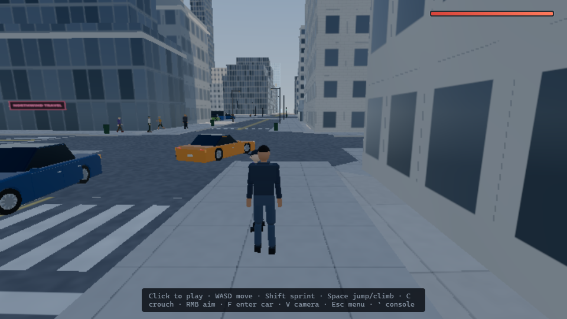
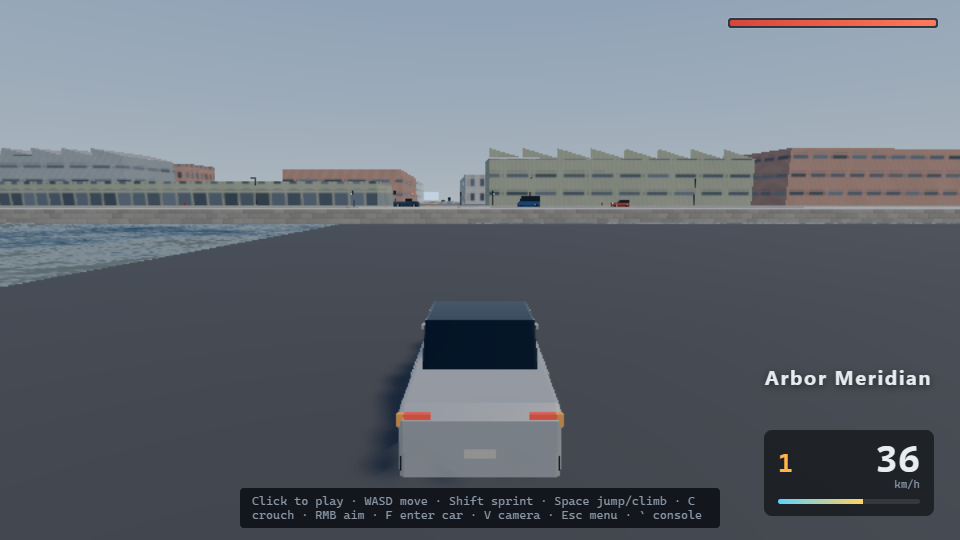

# HARBOR CITY

**An original open-world crime game that runs in the browser.** Explore a procedurally generated harbour city on
foot, by car, by motorbike and by boat, among AI traffic and crowds of pedestrians. Built with TypeScript, Three.js and
Rapier physics. Every building, vehicle, character and animation is generated in code; the game uses no external art
or audio assets.

**Built by [Chamindu Dharmawickrama](https://github.com/Chamindu-Dharmawickrama) using Claude Opus 5.5.**

> **🚧 Work in progress: 5 of 13 milestones done (M0–M4).** The city, on-foot movement, driving, traffic and
> pedestrians are playable as a sandbox. Combat, police and missions are not in yet. See
> [Project status](#project-status).

| | |
|---|---|
|  |  |
| Meridian (downtown), seen from the harbour | Gantry Point docks |
|  |  |
| Street level: AI traffic, taxis and pedestrians | Driving: chase camera, gear and speed readout |

<sub>Screenshots are taken by the automated end-to-end tests (Low preset, software renderer). Proper lighting, weather
and post-processing arrive in milestone M8.</sub>

---

## Contents

- [The game](#the-game)
- [What works today](#what-works-today)
- [Project status](#project-status)
- [Getting started](#getting-started)
- [Controls](#controls)
- [Developer tools](#developer-tools)
- [Tech stack](#tech-stack)
- [Architecture](#architecture)
- [Testing and quality gate](#testing-and-quality-gate)
- [Performance](#performance)
- [Known limitations](#known-limitations)
- [Original IP](#original-ip)
- [Credits](#credits)

---

## The game

You arrive in Harbor City with nothing. The finished game will have you stealing cars, taking jobs from crime bosses,
fighting the HCPD and working through 10 story missions and a set of side activities. The design is in
[PLAN.md](PLAN.md). This README describes what is built so far.

The city is three islands joined by two bridges and a tunnel, with about 3 km² of land in a 2.6 × 2.2 km world:

| District | Character |
|---|---|
| **Meridian** (Downtown) | Towers, plazas, neon, nightlife |
| **Gantry Point** (Industrial docks) | Warehouses, cranes, container yards, piers |
| **Linden Heights** (Suburbs) | Houses, parks, strip malls, gentle hills |

**Copperline Bridge** joins the docks and downtown, **Halvard Bridge** joins downtown and the suburbs, and the
**Undertow Tunnel** runs under the water from the docks to the suburbs.

## What works today

### The city
- Generated from a seed: islands, road network (warped grids, ring road, bridges, tunnel), blocks, lots, buildings,
  shop signs, street furniture and parking spots.
- Deterministic: the same seed produces a byte-identical city in Node and in Chrome, and a test checks this.
- Generated in Web Workers and streamed in 128 m chunks, with near/mid/far detail rings and occlusion culling. The
  visible city takes about 95 draw calls on the Medium preset.

### On foot
- Walk, sprint (with stamina), crouch, jump, climb ledges and swim. Falls cause damage. When you die the
  **FLATLINED** screen shows and you respawn.
- Procedural animation: hand-keyed clips, crossfades, an upper-body aim layer, hit flinches, and foot IK on kerbs and
  slopes.
- A third-person camera that does not clip through walls. Every frame is checked. There is also an over-the-shoulder
  aim view.
- Keyboard and mouse, or gamepad. Every control can be rebound, and settings are saved in the browser.

### Vehicles
- 13 road vehicles (compact, sedan, taxi, sports, muscle, pickup, van, bus, motorbike, police, ambulance, SWAT truck,
  armoured truck) and 2 boats.
- Custom raycast vehicle physics: a tire model with combined slip, torque curves, clutch, an automatic gearbox (manual
  is optional), limited-slip differential, ABS, traction control and aerodynamic drag. Boats float on buoyancy
  springs.
- An automated handling harness tests every class for acceleration, top speed, braking, cornering grip and
  stability.
- You can steal parked cars, smash the window and hotwire locked ones, or pull drivers out.
- Damage: dents, cracked and shattered glass, wheels torn off, engine fire, and explosions that can set off nearby
  cars.
- Camera views: chase near, chase far, hood and driver's seat.

### Traffic and pedestrians
- Lane-following AI traffic: car-following, traffic lights with signal phases, right of way at junctions, lane
  changes, and stop-or-go decisions on amber.
- Drivers react to the world. They pull over for sirens, flee gunfire, put the hazards on or abandon the car after a
  knock, and you can carjack them.
- Pedestrians follow daily routines on the sidewalk network. They cross on the walk signal, dodge cars, panic and
  flee, and ragdoll when hit.
- Density follows the time of day and the district, capped by the quality preset.
- The test suite runs a 10-minute headless simulation of 160 cars: no red-light runs and no junction conflicts.

### Engine and tooling
- Fixed 60 Hz simulation with interpolated rendering, a custom entity-component-system and Rapier physics (WASM).
- Debug overlay with per-system timings, a developer console, a free-fly camera and a GPU benchmark runner.

## Project status

_Last updated: 27 November 2026. Milestone M4 is done and M5 is next._

| # | Milestone | Status | Highlights |
|---|---|---|---|
| M0 | Scaffold, game loop, debug overlay, CI | ✅ Done | Fixed-step loop, ECS, Rapier physics, input (keyboard, mouse, gamepad), dev console, CI |
| M1 | Terrain, roads, buildings, streaming | ✅ Done | Seeded city, worker generation, chunk streaming, LOD, occlusion culling |
| M2 | Player controller, camera, animation | ✅ Done | Character controller, climbing, swimming, procedural animation, camera never clips |
| M3 | Vehicles | ✅ Done | 13 road vehicles and 2 boats pass the handling harness; stealing, damage, explosions |
| M4 | Traffic and pedestrians | ✅ Done | Lane AI, traffic signals, crowds, ragdolls; 0 red-light runs in the 10-minute city sim |
| M5 | Combat, weapons, enemy AI | 🔜 Next | 9 weapons, per-bone hitboxes, enemies that take cover, flank and retreat, gamepad lock-on |
| M6 | Heat (wanted level) and police | Planned | Witnesses, heat badges 1–6, pursuits, roadblocks, spike strips, helicopter, Fresh Coat, CUFFED |
| M7 | Mission framework, missions 1–3 | Planned | Mission scripting, markers, dialogue subtitles, checkpoints and retry |
| M8 | Day/night, weather, lighting, post-processing | Planned | Sky, rain and fog, wet roads, cascaded shadows, SSAO, bloom, night neon |
| M9 | Audio and radio | Planned | Procedural engine sounds, gunshots, ambience, three generated-music radio stations |
| M10 | HUD, menus, map, economy, save/load | Planned | Minimap with GPS, full map, shops, safehouses, garages, IndexedDB saves |
| M11 | Missions 4–10 and side activities | Planned | Rest of the story, taxi, courier, street races, Stashes, Mayhem |
| M12 | Optimisation, polish, final playtest | Planned | Profile-driven optimisation, bug-bash, final playtest |

**Test counts at M4:** 388 unit and physics integration tests, 34 Playwright end-to-end tests.

**Not in yet:** weapons and combat, police, missions and story, sound, day/night lighting and weather visuals, the map,
money and saving. For now the game is a sandbox: walk, drive and explore.

## Getting started

**You need** Node.js 22.12 or newer (developed on Node 24) and a desktop browser with WebGL2. It is developed and tested
in Chromium-based browsers.

```bash
git clone https://github.com/Chamindu-Dharmawickrama/HARBOR-CITY-open-world-crime-game.git
cd HARBOR-CITY-open-world-crime-game
npm install
npm run dev
```

Open the printed URL (default http://localhost:5173), then click the view to capture the mouse and start playing.

For a production build, run `npm run build` (output in `dist/`) and then `npm run preview`.

**URL options**

| Option | Effect |
|---|---|
| `?preset=low\|medium\|high` | Graphics quality preset |
| `?seed=<number or text>` | Generate a different city |
| `?debug=1` | Show the debug overlay at start |
| `?scene=playground` | Load the physics playground instead of the city |

## Controls

Click the view to capture the mouse. Every control can be rebound in **Esc → Controls**, and your bindings are saved
in the browser.

### On foot

| Action | Keyboard / mouse | Gamepad |
|---|---|---|
| Move | W A S D | Left stick |
| Look | Mouse | Right stick |
| Sprint (uses stamina) | Shift | Left stick click |
| Walk (hold) | Z | Tilt the stick gently |
| Jump / climb a ledge / climb out of water | Space | A |
| Crouch (toggle) | C or Left Ctrl | B |
| Aim (over the shoulder) | Right mouse | LT |
| Swap aim shoulder | X | Right stick click |
| Camera distance | V | Back |
| Pause menu | Esc or P | Start |

### Vehicles

| Action | Keyboard / mouse | Gamepad |
|---|---|---|
| Get in / out (walk up to a car; at speed this bails out) | F | Y |
| Accelerate / brake and reverse | W / S | RT / LT |
| Steer | A D | Left stick |
| Handbrake | Space | RB |
| Horn / siren (emergency vehicles) | H | Left stick click |
| Camera: chase near → far → hood → driver's seat | V | Back |
| Look around | Mouse | Right stick |
| Manual gearbox (after `gearbox manual`) | E up / Q down | B / X |

For a locked car, press F to smash the window, then hold still while it hotwires. For an occupied car, F pulls the
driver out.

## Developer tools

| Tool | How |
|---|---|
| Debug overlay | F3 (or `?debug=1`): FPS, frame-time graph, per-system timings, draw calls, streaming queue |
| Physics collider lines | F4 |
| Console | `` ` `` (backtick), then type `help` |
| Free-fly camera | `fly` (WASD, E/Q up/down, Shift fast); `goto <place>` also switches to it |
| Obstacle course | `course`, then `tpplayer wall12\|wall26\|tower10\|tower30\|water\|ceiling\|wallwalk` |
| Player state | `damage <n>`, `heal`, `armor`, `kill`, `respawn`, `tpplayer <x> <z>` |
| Vehicles | `spawncar <id> [enter\|locked\|driver]`, `fix`, `explode`, `vdamage <n>`, `siren`, `gearbox manual\|auto`, `telemetry` (with F3) |
| Vehicle ids | `brisa` `meridian` `cab` `vireo` `brakker` `haul` `courier` `linewalker` `sprint` `interceptor` `medic` `bulwark` `vaultline` `gullwing` `patrol` |
| Driving pad | `course`, then `tpplayer pad` (200 m pad with ramp), `tpplayer barrier` (crash wall), `tpplayer mooring` (boats) |
| Traffic and crowds | `traffic on\|off\|clear`, `peds on\|off\|clear`, `time HH:MM [game min/s]`, `lanes` (draws lanes, junction paths, signals and pedestrian routes), `nearsignal`, `gunshot`, `pedtest` |

The physics playground (`?scene=playground`) uses the fly camera. Left click throws a box.

## Tech stack

| Area | Choice |
|---|---|
| Language | TypeScript 6.0 (strict) |
| Build and dev server | Vite 8 |
| Rendering | Three.js 0.187, WebGL2 |
| Physics | Rapier 0.21 (`@dimforge/rapier3d-compat`, WASM, loaded as its own chunk) |
| Tests | Vitest 5 (unit and physics integration, Rapier running in Node), Playwright 1.65 (end-to-end) |
| Code quality | ESLint 10 with typescript-eslint, Prettier, dependency-cruiser |
| CI | GitHub Actions |

The only runtime dependencies are Three.js and Rapier. Everything else (ECS, vehicle physics, traffic model,
animation, city generator) is written for this project.

## Architecture

```
src/
├── core/        game loop, events, seeded RNG, input, time of day, maths and pools
├── ecs/         entity-component-system (generational ids, typed-array stores, cached queries)
├── physics/     Rapier world wrapper, collision groups
├── rendering/   renderer, quality presets, custom materials, cameras
├── save/        versioned settings storage
├── world/       city generation (pure and deterministic), mesh building, chunk streaming
├── characters/  character controller, player, NPCs, animation, ragdolls
├── vehicles/    vehicle physics, boats, rendering, damage, driving and theft
├── ai/          traffic simulation, lane network, pedestrians and crowd, density
├── ui/          HUD, pause menu, controls panel, status screens
├── debug/       overlay, console commands, probes, test API
├── game/        composition root: wires systems and scenes together
└── content/     pure data: vehicles, animations, population, …
```

Main ideas:

- **Strict layers.** Each folder may import only from the layers below it (core → ecs → physics/rendering/save →
  world → characters → vehicles → … → game). Lint enforces this with dependency-cruiser, so upward, sideways and
  circular imports fail the build.
- **Fixed-step simulation.** Gameplay runs at 60 Hz with up to 5 steps per frame. Rendering interpolates between
  ticks. Systems are registered in an explicit order, and the overlay times each one.
- **Deterministic and seeded.** `Math.random` is banned in favour of seeded RNG streams. Simulation code uses the game
  clock, never wall time. Lint enforces both rules.
- **No allocations on hot paths.** Hot code uses typed arrays, object pools and module-level scratch objects.
- **Procedural everything.** No textures or models are loaded. Looks come from per-vertex data and custom shader
  chunks on Three.js standard materials, so shadows and fog keep working.

[PLAN.md](PLAN.md) has the full architecture, system designs, performance budgets, risk register and the acceptance
criteria for each milestone.

## Testing and quality gate

| Command | What it does |
|---|---|
| `npm run typecheck` | TypeScript across the source, Node config and e2e projects |
| `npm run lint` | ESLint, Prettier check, layer rules (dependency-cruiser) |
| `npm run test` | Vitest unit tests and physics integration tests (Rapier in Node) |
| `npm run test:e2e` | Production build, then Playwright smoke tests (screenshots in `test-results/screenshots/`) |
| `npm run ci` | All of the above: the gate every milestone has to pass |
| `npm run bench` | Headed GPU benchmark → `bench-results/*.json` (`-- --presets=low,medium,high --scenario=flythrough\|traffic\|playground --vsync`) |

The end-to-end tests play the game through a virtual input device, the same input path a player uses, with no
shortcuts. GitHub Actions runs `npm run ci` on every push to `main` and on every pull request.

## Performance

Targets at 1080p: **Medium** on an AMD Radeon 780M integrated GPU and **High** on an NVIDIA RTX 3050 Laptop GPU.

| Benchmark | Hardware · preset | Result | Measured at |
|---|---|---|---|
| City flythrough | Radeon 780M · Medium | 90 fps with vsync, 3.6 ms CPU per frame, 0 frames over 50 ms | M3 |
| City flythrough | RTX 3050 Laptop · High | 90 fps with vsync | M1 |
| Rush-hour traffic | Radeon 780M · Medium | 90 fps with vsync, 7.9 ms CPU per frame (26 cars, 42 pedestrians) | M4 |
| Rush-hour traffic | RTX 3050 Laptop · High | 89 fps with vsync (38 cars, 62 pedestrians), 0 frames over 50 ms | M4 |

## Known limitations

The full list is in [PLAN.md §8](PLAN.md#8-known-limitations-smaller-but-fully-working-versions). The main ones today:

- Everything listed under **Not in yet** in [Project status](#project-status).
- Street lamps glow at night (`night` console command), but they do not light the ground until the M8 lighting pass.
- Buildings are solid and cannot be destroyed. Interiors (shops, safehouses, mission locations) come with later
  milestones.
- The player on foot is not knocked down by vehicles yet; cars stop against the player. This arrives in M5.
- The pause menu is mouse-driven. A gamepad opens and closes it, but cannot navigate the controls page yet (M10).
- City generation is verified identical in Chrome and Node. Other browser engines may differ in rare details for the
  same seed.
- Physics runs on the main thread.

## Original IP

Harbor City is an original game. Its districts, characters, vehicles, shops and radio stations are all invented. Genre
staples have their own names: **FLATLINED** (death), **CUFFED** (arrest), **Fresh Coat** (respray), **heat badges**
(wanted level), **Stashes** (hidden collectibles) and **Mayhem** (rampages). A test scans all source files for
franchise names and real-world brands, and the build fails if it finds one.

## Credits

**Built by [Chamindu Dharmawickrama](https://github.com/Chamindu-Dharmawickrama) using Claude Opus 5.5.**

Every milestone commit is co-authored with Claude Opus 5.5.
